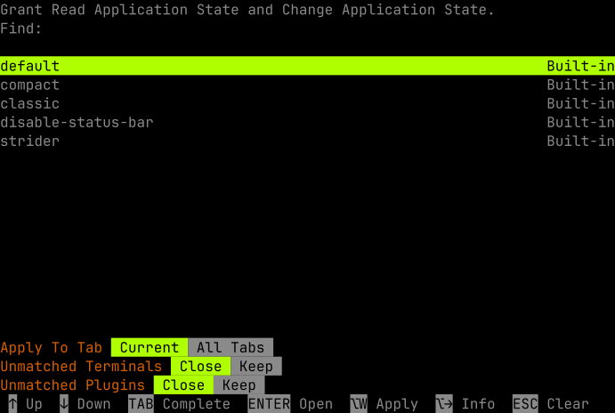

# Zellij Layout Manager

[](https://github.com/fulldecent/zellij-layout-manager-ng/actions/workflows/lint.yml) [](https://github.com/fulldecent/zellij-layout-manager-ng/actions/workflows/build-test.yml)

A window for choosing a Zellij layout. Open one as new tabs, apply one to the session, or save a new layout from the session or from pasted KDL.



This is a [Zellij](https://zellij.dev/) plugin and supports Zellij 0.45 or newer.

## Try it out

1. Select the latest wasm release and install to your plugins folder:

   ```sh
   name="com.github.fulldecent.zellij-layout-manager-ng.wasm"
   base="https://github.com/fulldecent/zellij-layout-manager-ng/releases/latest/download"
   mkdir -p ~/.config/zellij/plugins
   curl -fL -o ~/.config/zellij/plugins/"$name" "$base/$name"
   curl -fL -o ~/.config/zellij/plugins/"${name}.sigstore.jsonl" "$base/${name}.sigstore.jsonl"
   ```

   If you have the `gh` command, verify the file build attestation:

   ```sh
   gh attestation verify ~/.config/zellij/plugins/"$name" \
     -R fulldecent/zellij-layout-manager-ng \
     --bundle ~/.config/zellij/plugins/"${name}.sigstore.jsonl"
   ```

2. Start a new session (or tab if already in Zellij):

   ```sh
   zellij --layout-string 'layout {
       pane size=1 borderless=true {
           plugin location="tab-bar"
       }
       pane
       pane size=1 borderless=true {
           plugin location="status-bar"
       }
       floating_panes {
           pane name="Layouts" focus=true x="10%" y="8%" width="80%" height="75%" {
               plugin location="file:~/.config/zellij/plugins/com.github.fulldecent.zellij-layout-manager-ng.wasm"
           }
       }
   }'
   ```

   Grant `Read Application State` and `Change Application State` when Zellij asks. Click that pane and press `y`.

## Usage

The window has three pages. Layouts is the list. Layouts > a name is one layout. Layouts > New records a layout or imports one. That name is the floating pane border. It changes when the page changes. The list opens in Find, and the border is then Layouts > Find. After Find is closed, the border is Layouts.

The bar at the bottom is a row of keys. A key and its label are one control. Click either one. The choice words, such as None and Current, use the tab ribbon. The selected choice is the active ribbon.

### Layouts

The list is every `.kdl` file in the layout directory (`layout_dir`, otherwise `~/.config/zellij/layouts`), including a file that fails to parse, and the built-in layouts `default`, `compact`, `classic`, `strider`, and `disable-status-bar`.

A file shows its age as now, minutes, hours, or days. A built-in row says Built-in. Files come first, newest first. Built-ins follow, in the order `default`, `compact`, then the rest by name.

The page opens on `Find:`. Type to filter. The match is fuzzy, and matched characters are marked. An empty query lists every layout. Up and Down move through the matches and wrap. TAB fills the query with the selected name. ESC or `Ctrl c` clears a query that has text. On an empty query, those keys leave Find.

While Find is open, Left and Right move the cursor. `Ctrl a` and `Ctrl e` jump to the ends. `Ctrl` with Left, Right, Backspace, or Delete moves or deletes a word, and so does `Alt` except `⌥→`, which opens the layout page. `Ctrl z` undoes. `Ctrl y` redoes.

| Key   | Action                                                     |
| ----- | ---------------------------------------------------------- |
| ENTER | Open the selection as new tabs, then close this window     |
| ⌥W    | Apply the selection to the session, then close this window |
| ↑ ↓   | Move the selection                                         |
| TAB   | Complete the selected name, while Find is open             |
| ⌥→    | Open the selected layout's page                            |
| ESC   | Clear Find, leave Find, or close the window                |
| /     | Open Find again                                            |
| →     | Open the selected layout's page, after Find is closed      |
| N     | Open New, after Find is closed                             |
| T     | Toggle Unmatched Terminals, after Find is closed           |
| P     | Toggle Unmatched Plugins, after Find is closed             |
| A     | Toggle Apply To Tab, after Find is closed                  |

Click a row to select it. Click the selected row to open its page.

While `Find:` is open, Apply To Tab, Unmatched Terminals, and Unmatched Plugins are words beside the choices. A typed letter goes into `Find:`, so `A`, `T`, and `P` are not drawn as keys. They appear after Find is closed. Click a choice either way.

ENTER creates one new tab for each tab in the layout. A built-in layout, or a file with one tab, renames the first new tab to the layout name. ENTER and ⌥W do nothing for a file that failed to parse.

⌥W puts the selected layout on the tab. Apply To Tab chooses the current tab or every tab. Moving the selection sets that choice. A built-in layout or a one-tab file uses Current. Any other layout uses All Tabs. Unmatched Terminals and Unmatched Plugins start on Close, the same start as the built-in layout manager. Close drops a shell or a plugin that has no slot in the layout. Keep leaves that same pane on screen. Click a choice either way.

### Layouts > a name

The page says what the layout contains.

A built-in layout says that it is built in. ESC returns to the list.

A file lists its named panes. A name is the pane title, or else the command, the edited filename, or the plugin location. Unnamed shells are counted as terminals. Built-in plugins, such as the tab bar and the status bar, are left out. A file with more than one tab also lists the tab names. An unnamed tab is numbered.

| Key | Action                                                                                                                 |
| --- | ---------------------------------------------------------------------------------------------------------------------- |
| E   | Open the `.kdl` file in `$EDITOR`. The window stays open                                                               |
| R   | Rename the file. ENTER saves `<new>.kdl` and will not replace an existing file. An empty name is rejected. ESC cancels |
| DEL | Delete the file, with no confirmation. The row leaves the list immediately                                             |
| M   | Show or hide the parse diagnostic, for a file that failed to parse                                                     |
| ESC | Leave the diagnostic, cancel a rename, or return to the list                                                           |

A built-in layout has no file, so Edit, Rename, and Delete are absent. A failed delete is reported, and the row returns when Zellij sends the list again. A diagnostic taller than the page omits the middle and says how many lines were omitted.

### Layouts > New

S Session and I Import switch the page.

Session dumps the current session. This window is left out of the dump. The preview uses the same pane and tab list as a layout page.

| Key   | Action                                                                                                                     |
| ----- | -------------------------------------------------------------------------------------------------------------------------- |
| TAB   | Switch between All Tabs and Current Tab, then dump again                                                                   |
| U     | Dump again                                                                                                                 |
| R     | Edit the name. ENTER or ESC leaves the name and stays on this page                                                         |
| ENTER | Save `<name>.kdl` in the layout directory. An empty name receives an adjective-noun name. An existing file is not replaced |
| ESC   | Return to the list                                                                                                         |

A failed save stays on this page. A failed dump returns to the list and shows the error.

Import shows a `Layout:` field. Paste into this pane, or type. The text stays on the page. A layout that parses is previewed and saved the same way as a session. A layout that does not parse shows the KDL diagnostic, including the source line and a link to the layout documentation. On this page the letters go into the layout, so Session, Import, and Name are clicks.

## Development

Thank you for taking an interest in improving Zellij Layout Manager.

You will need Git, your platform's native build tools and the Rust tooling described in [rust-toolchain.toml](rust-toolchain.toml). We recommend rustup to manage your rust tooling, but install it using your system package manager rather than the dangerous methods on the rustup website ([ref](#references)).

### Linux

On Ubuntu 22.04+ or Debian 12+:

```sh
sudo apt update
sudo apt install git build-essential rustup
```

On Fedora:

```sh
sudo dnf install git gcc rustup
```

If your distribution has no `rustup` package, follow [other rustup installation methods](https://rust-lang.github.io/rustup/installation/other.html).

### macOS

```sh
xcode-select --install
brew install git rustup
```

Homebrew's `rust` formula is a standalone compiler. It does not honor `rust-toolchain.toml`. Use `rustup` instead.

### Windows

```powershell
winget install --exact --id Git.Git
winget install --exact --id Microsoft.VisualStudio.2022.BuildTools --override "--wait --passive --norestart --add Microsoft.VisualStudio.Workload.VCTools --includeRecommended"
winget install --exact --id Rustlang.Rustup
```

Clone the project and build. On Linux and macOS:

> [!NOTE]
> If you do not require cross compilation, remove the `DYLD_LIBRARY_PATH="..."` part of all commands in this README.

```sh
git clone https://github.com/fulldecent/zellij-layout-manager-ng.git
cd zellij-layout-manager-ng
rustup show
cargo_bin=$(rustup which cargo)
export PATH="$(dirname "$cargo_bin"):$PATH"
export DYLD_LIBRARY_PATH="$(cd "$(dirname "$cargo_bin")/../lib" && pwd)" # macOS only; omit on Linux
cargo check --locked
cargo build --locked
```

In PowerShell:

```powershell
git clone https://github.com/fulldecent/zellij-layout-manager-ng.git
Set-Location zellij-layout-manager-ng
rustup show
$cargo = rustup which cargo
if (-not $cargo) { exit 1 }
$bin = Split-Path $cargo
$env:PATH = "$bin;$env:PATH"
cargo check --locked
cargo build --locked
```

Run this directly with:

```sh
zellij --layout layout/dev.kdl
```

[layout/dev.kdl](layout/dev.kdl) opens a focused floating pane named Layouts. The plugin path is relative to the directory where you start Zellij.

### Testing

```sh
rustup show
cargo_bin=$(rustup which cargo)
export PATH="$(dirname "$cargo_bin"):$PATH"
export DYLD_LIBRARY_PATH="$(cd "$(dirname "$cargo_bin")/../lib" && pwd)" # macOS only; omit on Linux
cargo test --locked --target "$(rustc -vV | sed -n 's/^host: //p')"
cargo fmt --all -- --check
cargo clippy --all-targets --locked -- -D warnings
cargo build --release --locked
```

`cargo test` runs the Rust tests in `src/`. [tests/snapshot.sh](tests/snapshot.sh) builds the release wasm, runs every script in [shots/](shots/), and exits non-zero unless those bytes match the committed `shots/*.ansi.txt` files. SVG is traced. `diff` does not compare it. The picture is committed as [screenshot.svg](screenshot.svg) at the repository root.

```sh
rustup show
cargo_bin=$(rustup which cargo)
export PATH="$(dirname "$cargo_bin"):$PATH"
export DYLD_LIBRARY_PATH="$(cd "$(dirname "$cargo_bin")/../lib" && pwd)" # macOS only; omit on Linux
cargo install zellij-plugin-snapshot --version 0.2.2 --locked
sh tests/snapshot.sh
```

The host is [Zellij Plugin Snapshot](https://github.com/fulldecent/zellij-plugin-snapshot) 0.2.2. Install that published crate once. `cargo install` compiles it and puts `zellij-plugin-snapshot` on `PATH`. `[dependencies]` would compile it into the plugin wasm. This host is a command, so that field leaves it uninstalled.

`tests/snapshot.sh` passes `--target wasm32-wasip1`. [.cargo/config.toml](.cargo/config.toml) selects that target for a plain `cargo build`. The flag keeps the snapshot build on the plugin wasm if that default is removed.

```sh
npx prettier@latest --check . --write
npx markdownlint-cli@latest "**/*.md" --fix
```

### Releases

Use `fix:`, `feat:` or `BREAKING CHANGE:` in your commit messages. When you push commits to `main`, the release workflow will create a pull request which bumps the version and kicks off a release when you merge.

The [release workflow](.github/workflows/release.yml) uses Release Please's `rust` release type. That pull request bumps the version in [Cargo.toml](Cargo.toml) and [Cargo.lock](Cargo.lock). The package name is `plugin`. `include-component-in-tag: false` keeps the tag `vMAJOR.MINOR.PATCH`. A tag shaped `plugin-v1.2.3` does not pass the publish step.

The released binary is named `com.github.fulldecent.zellij-layout-manager-ng.wasm`. [Build and test](.github/workflows/build-test.yml) builds and tests that wasm, then attests and uploads it. The release also includes `com.github.fulldecent.zellij-layout-manager-ng.wasm.sigstore.jsonl`. The sidecar records the release version. The wasm file name is stable across versions.

In GitHub repository settings, under Actions, General, Workflow permissions, select read and write permissions and check "Allow GitHub Actions to create and approve pull requests". Under General, Releases, enable release immutability. Attestations are available for public repositories. Private repositories require GitHub Enterprise Cloud.

Set the starting tag on the current `main` commit. `v0.0.0` is the version Release Please counts forward from. Run these commands from a clone of this repository. `gh` fills in `{owner}/{repo}` from that clone.

```sh
gh api --method POST repos/{owner}/{repo}/git/refs \
  -f ref="refs/tags/v0.0.0" \
  -f sha="$(gh api repos/{owner}/{repo}/commits/main --jq .sha)"
```

### Maintenance

The project administrator completes these maintenance tasks each month.

1. Identify external Actions in [.github/workflows](./.github/workflows) and update them when it is safe.
1. Review the Rust toolchain in `rust-toolchain.toml`.
1. Review [zellij-plugin-snapshot](https://github.com/fulldecent/zellij-plugin-snapshot) releases. Update every `cargo install zellij-plugin-snapshot --version` line. Regenerate each `shots/*.ansi.txt` and its SVG when the host output changes. Commit [screenshot.svg](screenshot.svg) at the repository root. Commit the other SVG files beside their YAML scripts.

## Project scope

This window is for people who keep more than one Zellij layout and want to open, apply, or record one without leaving the session.

In scope:

- List layout files and the five built-in layouts named above
- Open a layout as new tabs, or apply it to the current tab or to every tab
- Choose whether panes already open are closed when a layout is applied, and whether that covers the current tab or every tab
- Read one layout, edit its file, rename it, delete it, or read a parse diagnostic
- Record the current session, or import pasted KDL, into the layout directory

Out of scope:

- Replacing the built-in `zellij:layout-manager` alias in a stock layout
- Swap layouts, `welcome`, and `no-plugins`
- Loading a layout from an HTTPS URL

## References

1. Button labels use title case. A labeled button is a key, a label, and one pad on each side. Choice words use the tab ribbon. The rules are the ones in [zellij-status-bar-ng 1.1.1](https://github.com/fulldecent/zellij-status-bar-ng), [zellij-compact-bar-ng 0.2.1](https://github.com/fulldecent/zellij-compact-bar-ng), and [zellij-tab-bar-ng 0.2.1](https://github.com/fulldecent/zellij-tab-bar-ng), collected in Zellij Style Guide Next Generation.
1. This project is built based on [best practices documented in zellij-plugin-template](https://github.com/fulldecent/zellij-plugin-template), release 0.5.0.
1. Layout files, built-in names, and the open, apply, save, rename, delete, and parse commands follow Zellij 0.45.1. The built-in screen is [`default-plugins/layout-manager` at v0.45.1](https://github.com/zellij-org/zellij/tree/v0.45.1/default-plugins/layout-manager). This window puts that work on three pages.
1. `override_layout` keeps panes the layout names, opens panes it adds, and closes the rest unless a retain flag says otherwise. See [Override layout](https://zellij.dev/documentation/cli-actions.html#override-layout).
1. We use a workaround so that rustup works without replacing your system Rust programs ([issue](https://github.com/rust-lang/rustup/issues/5025#issuecomment-6869331794)).
1. Render snapshots follow [Zellij Plugin Snapshot](https://github.com/fulldecent/zellij-plugin-snapshot) 0.2.2.
1. This project is released under the [MIT license](./LICENSE.md).
